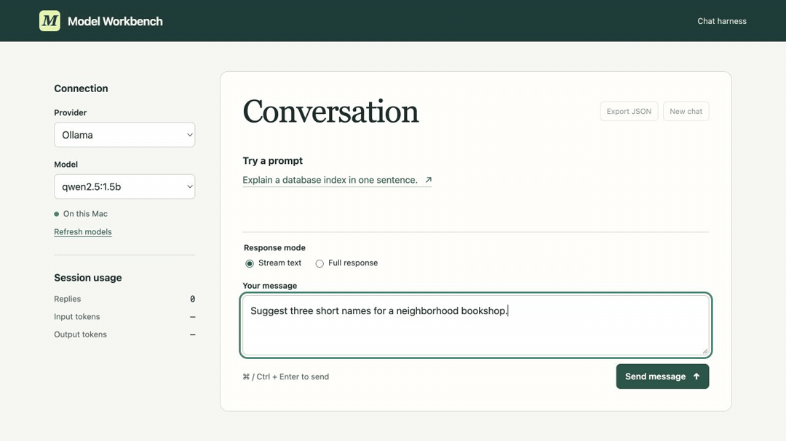

# Model Workbench

Compare chat models on your computer with Ollama or connect a compatible Chat
Completions API. Choose **Stream text** to read an answer as the model generates
it, or **Full response** to see it all at once. You can switch modes between
messages in the same conversation.



In the recording, both models received “Suggest three short names for a
neighborhood bookshop.” The times and token counts are from those two local runs.

| Model | Response mode | First suggestion | Elapsed | Input / output tokens |
| --- | --- | --- | ---: | ---: |
| Qwen2.5 1.5B | Stream text | Book Haven | 0.55 s | 40 / 19 |
| SmolLM2 135M | Full response | The Book Thief | 2.02 s | 40 / 107 |

Each provider and model has its own conversation in the browser tab. **Export
JSON** downloads the completed turns and their measurements. Reloading the tab
clears its history.

## Run the workbench

With Python 3.10+ and a running Ollama installation:

```sh
git clone https://github.com/heyfoz/model-workbench.git
cd model-workbench
python3 -m venv .venv
source .venv/bin/activate
python -m pip install -r server/requirements-harness.txt
ollama pull smollm2:135m
python server/harness.py
```

On Windows, activate with `.venv\Scripts\Activate.ps1` in PowerShell.
Open [the local workbench](http://127.0.0.1:4397). The Ollama picker discovers
installed chat models. SmolLM2 135M is a small first-run example. An existing
local chat model works too. To compare it with a larger model, run
`ollama pull qwen2.5:1.5b`, choose **Refresh models**, and send the same
question to each model.

## Use a second API

To try both HTTP interfaces against the same local model, start the server with:

```sh
CHAT_API_BASE=http://127.0.0.1:11434/v1 CHAT_API_MODEL=smollm2:135m python server/harness.py
```

Send a prompt under **Ollama**, then select **Chat Completions API** and send
the same prompt. Switch back to see the first conversation. The two routes
use Ollama's native `/api/chat` and the compatible `/v1/chat/completions`
endpoint respectively. [Ollama compatibility guide](https://docs.ollama.com/api/openai-compatibility)

To use a different service, set `CHAT_API_BASE` to its versioned base URL and
`CHAT_API_MODEL` to a chat model served there, then restart the workbench.
Set `CHAT_API_KEY` in the server environment when that service needs bearer
authentication. For example, NVIDIA's hosted base is
`https://integrate.api.nvidia.com/v1`. The provider picker identifies the
configured host. Each request sends that conversation to the selected provider.
Only the Flask process reads the key.

Run the harness tests with `python -m unittest discover -s tests`.

## Original OpenAI Flask and CLI examples

<div align="center">
  <video controls src="https://github.com/user-attachments/assets/0632a683-8c24-47a8-a3b9-7f2b0087e5e3" type="video/mp4">>
    Your browser does not support the video tag.
  </video>
</div>

This repository demonstrates a local client-server implementation of the OpenAI Chat Completion API, utilizing the powerful GPT-4o language model to create conversational AI applications. The example features a Python Flask server that interfaces with the OpenAI API and a Python client that communicates with the server to facilitate the conversation.

## About

The OpenAI Chat Completion API enables easy integration of AI-powered conversational capabilities into applications. The API uses the GPT-4o language model to understand and generate human-like text based on user input.

This project consists of two main components:

- **Server (`./server`):** A Flask application that processes incoming messages from the client, sends them to the OpenAI API, and returns the generated responses. It handles session state and conversation logging. You have two server options:
  - **Default Chat:** Standard chat mode where the entire response is sent at once.
  - **Streaming Chat:** Receives chunks of text to simulate dynamic typing, providing a more interactive experience.

- **Client (`./client`):** A command-line interface (CLI) that allows users to send messages to the Flask server and receive responses from the AI model. You can choose between:
  - **Default Chat Client:** For standard chat interactions.
  - **Streaming Chat Client:** For an experience where responses appear as if they are being typed out dynamically.

For more information about the OpenAI Chat Completion API, visit:
- [Playground](https://platform.openai.com/playground)
- [Chat Completions API Guide](https://platform.openai.com/docs/guides/gpt/chat-completions-api)
- [API Reference](https://platform.openai.com/docs/api-reference/chat)

## Features

- Interactive CLI for sending and receiving messages.
- Flask server for API requests and response handling.
- Support for both default and stream chat modes.
- Conversation persistence on both client and server sides.
- Customizable user identification for conversation logging.

## Authentication
The script requires an API key from OpenAI for authentication. Before running the script, set up an environment variable `OPENAI_API_KEY` with your OpenAI API key. Retrieve your API key from your [API Keys page on OpenAI](https://platform.openai.com/account/api-keys).

For assistance on setting up environment variables:
- On Windows, follow Microsoft's guide on [Environment Variables](https://learn.microsoft.com/en-us/windows/win32/procthread/environment-variables).
- On Linux/Unix, refer to the guide on [setting environment variables in Linux](https://linuxize.com/post/how-to-set-and-list-environment-variables-in-linux/).

## Setup

To get started with this example:

1. Clone the repository to your local machine.
2. Install the required dependencies by running `pip install -r requirements.txt` in both the `./client` and `./server` directories.
3. Set your OpenAI API key as an environment variable on your PC:

    - On **Windows Command Prompt**:
      ```bash
      setx OPENAI_API_KEY "your_api_key_here"
      ```

    - On **Windows PowerShell**:
      ```powershell
      [System.Environment]::SetEnvironmentVariable('OPENAI_API_KEY', 'your_api_key_here', 'User')
      ```

    - On **macOS/Linux**:
      ```bash
      export OPENAI_API_KEY='your_api_key_here'
      ```
      
4. Choose your server and client scripts:
   - **Default Chat:** 
     - Run the server with `python flask_default_chat.py` within the `/server` directory.
     - Run the client with `python default_chat.py` within the `/client` directory.
   - **Stream Chat:** 
     - Run the server with `python flask_stream_chat.py` within the `/server` directory.
     - Run the client with `python stream_chat.py` within the `/client` directory.

5. Follow the prompts in the client to begin a conversation with the AI.

6. Chat history files will be saved to the respective `./client/chat_history` and `./server/chat_history` directories.

## Contributions

Contributions to this example are welcome! If you have an improvement or encounter an issue, please feel free to open an issue or submit a pull request.

## License

This project is open-sourced under the MIT License. See the [LICENSE](LICENSE) file for more details.
